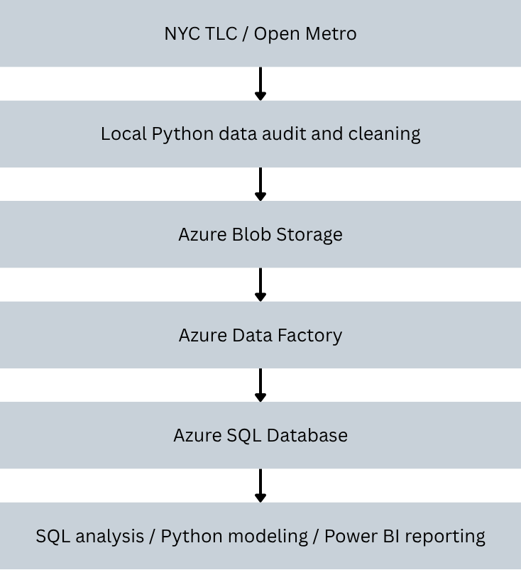
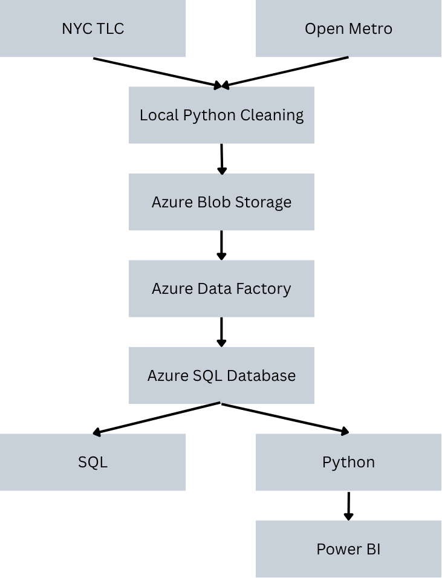

# NYC Yellow Taxi Janurary Analysis Report

Table of Contents

1. Executive Summary
2. Business Problem
3. Data Sources
4. Data Engineering Architecture
5. Data Quality & Cleaning
6. Exploratory / SQL Analysis
7. Statistical & ML Modeling
8. Power BI Dashboard
9. Key Findings
10. Business Recommendations
11. Limitations
12. Future Work

## 1. Executive Summary

This project analyzes New York Yellow Taxi activity during Janurary 2026 to understand when and where taxi demand generates the most revenue, how demand varies across time and location, and whether weather help explain changes in trip volume.

The analysis covers about 3.72 million trips generating $108.09 million in total revenue. Demand showed strongly hourly and weekly patterns, while pickup activity was heavily ceoncentrated in Manhattan. Airport trips, particularly those originating at JFK Airport, generated disproportionately high revenue compared with many high-volume Manhattan zones. A major decline in taxi activity was also observed during late-Janurary snow fall, with snow hours associated with substantially lower average hourly trip demand. 

SQL was used for KPI, zone, route, and weather analysis, while Pythonw was used for auditing, data cleaning, weather enrichment and machine learning modeling. Among the models evaluated, a second-order linear regression model produced the lowest test RMSE, outperforming Random Forrest, XGBoost, and Histogram Gradient Boosting on the Janurary dataset.

Overall, the findings suggest that taxi capacity should be concentrated around consistently high-demand Manhattan zones and high-value airport corridors, while operational planning should account for predictable hourly demand patterns and weather-related disruptions.

## 2. Business problem

Taxi demand is not evenly distributed across time, location, or weather conditions. Some hours and taxi zones generate significantly more trips and revenue than others, while external factors such as snowfall and precipitation may disrupt normal demand patterns.

For a taxi operator, fleet manager, or transportation platform, understanding these patterns can support better operational decisions such as where to position available vehicles, when additional capacity may be needed, and which geographic areas or routes generate the greatest economic value.

This project therefore focuses on four primary business questions:

1. When does Yellow Taxi demand peak during the day and throughout the week?
2. Which pickup zones and routes generate the highest trip volume and revenue?
3. How do weather conditions relate to changes in hourly taxi demand?
4. How accurately can hourly taxi demand be predicted using temporal and weather-related factors?

The overall objective is to translate historical trip data into actionable insights that could help improve vehicle allocation, operational planning, and revenue-focused decision making.

## 3. Data Sources

This project combines three primary dataset: NYC Yellow Taxi trip records, The NYC Taxi Zone lookup table, and hourly historical weather data for New York City.

* Overview Data Page : https://www.nyc.gov/site/tlc/about/tlc-trip-record-data.page

* Janurary Yellow Taxi Trip Records: https://d37ci6vzurychx.cloudfront.net/trip-data/yellow_tripdata_2026-01.parquet

* Yellow Taxi Data Dictionary: https://www.nyc.gov/assets/tlc/downloads/pdf/data_dictionary_trip_records_yellow.pdf

* Taxi Zone Lookup Table: https://d37ci6vzurychx.cloudfront.net/misc/taxi_zone_lookup.csv

| Dataset | Source | Granularity | Period | Primary Use |
|---|---|---|---|---|
| Yellow Taxi Trip Records | NYC TLC | Individual trip | Jan. 2026 | Demand, revenue, route analysis |
| Taxi Zone Lookup | NYC TLC | Taxi zone | Static | Geographic enrichment |
| Historical Weather | Open-Meteo | Hourly | Jan. 2026 | Weather-demand analysis |

### NYC Yellow Taxi Trip Records

The primary dataset was obtained from the New York Taxi City and Limousine Comission (NYC TLC). The analysis uses Yellow taxi records for Janurary 2026.

Each row represents an individual taxi trip and includes information:

Data Dictionary

* VendorID: A code indicating the TPEP provider that provided the record.
    1 = Creative Mobile Technologies, LLC
    2 = Curb Mobility, LLC
    6 = Myle Technologies Inc
    7 = Helix

* tpep_pickup_datetime : The date and time when the meter was engaged.
* tpep_dropoff_datetime: The date and time when the meter was disengaged. 
* passenger_count: The number of passengers in the vehicle. 
* trip_distance: The elapsed trip distance in miles reported by the taximeter.
* RatecodeID: The final rate code in effect at the end of the trip.
    1 = Standard rate
    2 = JFK
    3 = Newark
    4 = Nassau or Westchester
    5 = Negotiated fare
    6 = Group ride
    99 = Null/unknown
* store_and_fwd_flag: This flag indicates whether the trip record was held in vehicle memory before
    sending to the vendor, aka “store and forward,” because the vehicle did not
    have a connection to the server.
    Y = store and forward trip
    N = not a store and forward trip
* PULocationID: TLC Taxi Zone in which the taximeter was engaged.
* DOLocationID: TLC Taxi Zone in which the taximeter was disengaged.
* payment_type: A numeric code signifying how the passenger paid for the trip.
    0 = Flex Fare trip
    1 = Credit card
    2 = Cash
    3 = No charge
    4 = Dispute
    5 = Unknown
    6 = Voided trip
* fare_amount: The time-and-distance fare calculated by the meter. For additional
    information on the following columns, see
    https://www.nyc.gov/site/tlc/passengers/taxi-fare.page
* extra: Miscellaneous extras and surcharges.
* mta_tax: Tax that is automatically triggered based on the metered rate in use
* tip_amount: Tip amount – This field is automatically populated for credit card tips. Cash
    tips are not included.
* tolls_amount: Total amount of all tolls paid in trip.
* improvement_surcharge: Improvement surcharge assessed trips at the flag drop. The improvement
    surcharge began being levied in 2015.
* total_amount: The total amount charged to passengers. Does not include cash tips.
* congestion_surcharge: Total amount collected in trip for NYS congestion surcharge.
* airport_fee: For pick up only at LaGuardia and John F. Kennedy Airports.
* cbd_congestion_fee: Per-trip charge for MTA's Congestion Relief Zone starting Jan. 5, 2025

### NYC Taxi Zone Look up

The NYC TLC Taxi Zone Lookup table was used to translate numeric pickup and dropoff location IDs into meaningful geographic information.

The lookup table contains: 

* Location ID: The location which the taxi zone is connected to.
* borough: The borough where the taxi is in.
* taxi zone name: The name of the taxi zone.
* service zone: The name of the service zone.

Separate pickup and dropoff versions of the lookup table were used in the analytical model so that trip origins and destinations could be analyzed independently.

### Historical weather data

Hourly historical weather observation for NYC were retrieved using the Open-Metro Historical Weather API for Janurary 1 through Janurary 31, 2026.

The datset include:

|Variable|Unit|Description|
|--------|----|-----------|
|date|hourly|The time upon when the observation is recorded.|
|temperature_2m|°F|Air temperature at 2 meters above ground|
|precipitation|inch|Total precipitation (rain, showers, snow) sum of the preceding hour.|
|rain|inch|Rain from large scale weather systems of the preceding hour in millimeter|
|snowfall|inch|Snowfall amount of the preceding hour in inches.|
|wind_speed_10m|mph|Wind direction at 10 meters above ground.|

Weather data is recorded at an hourly level which connects to the aggregated of the yellow taxi trip by hour.

## 4. Data Engineering and Architecture

The project was designed as an end-to-end analytics pipeline rather than a standalone notebook analysis. Raw taxi, zone, and weather data were ingested, validated, transformed, stored in cloud services, and then consumed by SQL, Python, and Power BI for downstream analysis.

### Architecture Overview

The workflow followed this general structure:

### Data Ingestion

NYC Yellow Taxi trip records and the Taxi Zone Lookup table were obtained from NYC TLC sources. Historical hourly weather data for New York City were retrieved from the Open-Meteo Historical Weather API.

Python was used initially to inspect the structure and quality of the raw datasets, verify data types, identify missingness and invalid records, and produce cleaned CSV files for downstream ingestion.

### Cloud Storage

Cleaned source files were uploaded to Azure Blob Storage, which served as the cloud landing area for the project.

Using cloud object storage created a clear separation between raw/processed files and the analytical database.

### ETL with Azure Data Factory

Azure Data Factory was used to move data from Blob Storage into staging tables in Azure SQL Database.

The pipeline separated ingestion from transformation:

1. Files were copied from Blob Storage into staging tables.
2. Staging columns were initially loaded as text where appropriate.
3. SQL transformation scripts converted fields into strongly typed analytical tables using functions such as `TRY_CONVERT`.
4. Clean analytical tables were created for taxi trips, taxi zones, and hourly weather observations.

This staging-to-clean pattern helped preserve source data while allowing data type validation and transformation to occur in a controlled step.

### Azure SQL Analytical Layer

Azure SQL Database served as the central analytical store.

The primary tables included:

- `yellow_trips` — cleaned taxi trip-level data
- `taxi_zone_lookup_clean` — standardized taxi zone metadata
- `nyc_weather_hourly_clean` — hourly weather observations

The taxi trip table was joined to the taxi zone lookup for both pickup and dropoff locations, while weather observations were aligned to trips by pickup hour.

SQL was then used to perform KPI, time, geographic, route, and weather analysis.

### Analytics & Reporting Layer

Python was used for statistical analysis and machine-learning model development, including linear regression, polynomial regression, Random Forest, Histogram Gradient Boosting, and XGBoost.

Power BI was used as the reporting layer. The trip data, zone dimensions, and weather data were modeled through one-to-many relationships to support interactive filtering and dashboard visualizations.

This architecture allowed the project to separate data ingestion, storage, transformation, analysis, modeling, and reporting into distinct stages.

