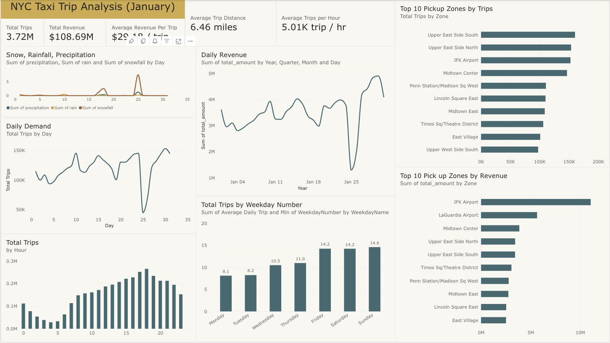

# NYC Yellow Taxi Janurary Analysis Report

Table of Contents

1. Executive Summary
2. Business Problem
3. Data Sources
4. Data Engineering Architecture
5. Data Quality & Cleaning
6. Exploratory / SQL Analysis
7. Statistical & ML Modeling
8. Power BI Dashboard
9. Key Findings
10. Business Recommendations
11. Limitations
12. Future Work

## 1. Executive Summary

This project analyzes New York Yellow Taxi activity during Janurary 2026 to understand when and where taxi demand generates the most revenue, how demand varies across time and location, and whether weather help explain changes in trip volume.

The analysis covers about 3.72 million trips generating $108.09 million in total revenue. Demand showed strongly hourly and weekly patterns, while pickup activity was heavily ceoncentrated in Manhattan. Airport trips, particularly those originating at JFK Airport, generated disproportionately high revenue compared with many high-volume Manhattan zones. A major decline in taxi activity was also observed during late-Janurary snow fall, with snow hours associated with substantially lower average hourly trip demand. 

SQL was used for KPI, zone, route, and weather analysis, while Pythonw was used for auditing, data cleaning, weather enrichment and machine learning modeling. Among the models evaluated, a second-order linear regression model produced the lowest test RMSE, outperforming Random Forrest, XGBoost, and Histogram Gradient Boosting on the Janurary dataset.

Overall, the findings suggest that taxi capacity should be concentrated around consistently high-demand Manhattan zones and high-value airport corridors, while operational planning should account for predictable hourly demand patterns and weather-related disruptions.

## 2. Business problem

Taxi demand is not evenly distributed across time, location, or weather conditions. Some hours and taxi zones generate significantly more trips and revenue than others, while external factors such as snowfall and precipitation may disrupt normal demand patterns.

For a taxi operator, fleet manager, or transportation platform, understanding these patterns can support better operational decisions such as where to position available vehicles, when additional capacity may be needed, and which geographic areas or routes generate the greatest economic value.

This project therefore focuses on four primary business questions:

1. When does Yellow Taxi demand peak during the day and throughout the week?
2. Which pickup zones and routes generate the highest trip volume and revenue?
3. How do weather conditions relate to changes in hourly taxi demand?
4. How accurately can hourly taxi demand be predicted using temporal and weather-related factors?

The overall objective is to translate historical trip data into actionable insights that could help improve vehicle allocation, operational planning, and revenue-focused decision making.

## 3. Data Sources

This project combines three primary dataset: NYC Yellow Taxi trip records, The NYC Taxi Zone lookup table, and hourly historical weather data for New York City.

* Overview Data Page : https://www.nyc.gov/site/tlc/about/tlc-trip-record-data.page

* Janurary Yellow Taxi Trip Records: https://d37ci6vzurychx.cloudfront.net/trip-data/yellow_tripdata_2026-01.parquet

* Yellow Taxi Data Dictionary: https://www.nyc.gov/assets/tlc/downloads/pdf/data_dictionary_trip_records_yellow.pdf

* Taxi Zone Lookup Table: https://d37ci6vzurychx.cloudfront.net/misc/taxi_zone_lookup.csv

| Dataset | Source | Granularity | Period | Primary Use |
|---|---|---|---|---|
| Yellow Taxi Trip Records | NYC TLC | Individual trip | Jan. 2026 | Demand, revenue, route analysis |
| Taxi Zone Lookup | NYC TLC | Taxi zone | Static | Geographic enrichment |
| Historical Weather | Open-Meteo | Hourly | Jan. 2026 | Weather-demand analysis |

### NYC Yellow Taxi Trip Records

The primary dataset was obtained from the New York Taxi City and Limousine Comission (NYC TLC). The analysis uses Yellow taxi records for Janurary 2026.

Each row represents an individual taxi trip and includes information:

Data Dictionary

* VendorID: A code indicating the TPEP provider that provided the record.
    1 = Creative Mobile Technologies, LLC
    2 = Curb Mobility, LLC
    6 = Myle Technologies Inc
    7 = Helix

* tpep_pickup_datetime : The date and time when the meter was engaged.
* tpep_dropoff_datetime: The date and time when the meter was disengaged. 
* passenger_count: The number of passengers in the vehicle. 
* trip_distance: The elapsed trip distance in miles reported by the taximeter.
* RatecodeID: The final rate code in effect at the end of the trip.
    1 = Standard rate
    2 = JFK
    3 = Newark
    4 = Nassau or Westchester
    5 = Negotiated fare
    6 = Group ride
    99 = Null/unknown
* store_and_fwd_flag: This flag indicates whether the trip record was held in vehicle memory before
    sending to the vendor, aka “store and forward,” because the vehicle did not
    have a connection to the server.
    Y = store and forward trip
    N = not a store and forward trip
* PULocationID: TLC Taxi Zone in which the taximeter was engaged.
* DOLocationID: TLC Taxi Zone in which the taximeter was disengaged.
* payment_type: A numeric code signifying how the passenger paid for the trip.
    0 = Flex Fare trip
    1 = Credit card
    2 = Cash
    3 = No charge
    4 = Dispute
    5 = Unknown
    6 = Voided trip
* fare_amount: The time-and-distance fare calculated by the meter. For additional
    information on the following columns, see
    https://www.nyc.gov/site/tlc/passengers/taxi-fare.page
* extra: Miscellaneous extras and surcharges.
* mta_tax: Tax that is automatically triggered based on the metered rate in use
* tip_amount: Tip amount – This field is automatically populated for credit card tips. Cash
    tips are not included.
* tolls_amount: Total amount of all tolls paid in trip.
* improvement_surcharge: Improvement surcharge assessed trips at the flag drop. The improvement
    surcharge began being levied in 2015.
* total_amount: The total amount charged to passengers. Does not include cash tips.
* congestion_surcharge: Total amount collected in trip for NYS congestion surcharge.
* airport_fee: For pick up only at LaGuardia and John F. Kennedy Airports.
* cbd_congestion_fee: Per-trip charge for MTA's Congestion Relief Zone starting Jan. 5, 2025

### NYC Taxi Zone Look up

The NYC TLC Taxi Zone Lookup table was used to translate numeric pickup and dropoff location IDs into meaningful geographic information.

The lookup table contains: 

* Location ID: The location which the taxi zone is connected to.
* borough: The borough where the taxi is in.
* taxi zone name: The name of the taxi zone.
* service zone: The name of the service zone.

Separate pickup and dropoff versions of the lookup table were used in the analytical model so that trip origins and destinations could be analyzed independently.

### Historical weather data

Hourly historical weather observation for NYC were retrieved using the Open-Metro Historical Weather API for Janurary 1 through Janurary 31, 2026.

The datset include:

|Variable|Unit|Description|
|--------|----|-----------|
|date|hourly|The time upon when the observation is recorded.|
|temperature_2m|°F|Air temperature at 2 meters above ground|
|precipitation|inch|Total precipitation (rain, showers, snow) sum of the preceding hour.|
|rain|inch|Rain from large scale weather systems of the preceding hour in millimeter|
|snowfall|inch|Snowfall amount of the preceding hour in inches.|
|wind_speed_10m|mph|Wind direction at 10 meters above ground.|

Weather data is recorded at an hourly level which connects to the aggregated of the yellow taxi trip by hour.

## 4. Data Engineering and Architecture

The project was designed as an end-to-end analytics pipeline rather than a standalone notebook analysis. Raw taxi, zone, and weather data were ingested, validated, transformed, stored in cloud services, and then consumed by SQL, Python, and Power BI for downstream analysis.

### Architecture Overview

The workflow followed this general structure:

### Data Ingestion

NYC Yellow Taxi trip records and the Taxi Zone Lookup table were obtained from NYC TLC sources. Historical hourly weather data for New York City were retrieved from the Open-Meteo Historical Weather API.

Python was used initially to inspect the structure and quality of the raw datasets, verify data types, identify missingness and invalid records, and produce cleaned CSV files for downstream ingestion.

### Cloud Storage

Cleaned source files were uploaded to Azure Blob Storage, which served as the cloud landing area for the project.

Using cloud object storage created a clear separation between raw/processed files and the analytical database.

### ETL with Azure Data Factory

Azure Data Factory was used to move data from Blob Storage into staging tables in Azure SQL Database.

The pipeline separated ingestion from transformation:

1. Files were copied from Blob Storage into staging tables.
2. Staging columns were initially loaded as text where appropriate.
3. SQL transformation scripts converted fields into strongly typed analytical tables using functions such as `TRY_CONVERT`.
4. Clean analytical tables were created for taxi trips, taxi zones, and hourly weather observations.

This staging-to-clean pattern helped preserve source data while allowing data type validation and transformation to occur in a controlled step.

### Azure SQL Analytical Layer

Azure SQL Database served as the central analytical store.

The primary tables included:

- `yellow_trips` — cleaned taxi trip-level data
- `taxi_zone_lookup_clean` — standardized taxi zone metadata
- `nyc_weather_hourly_clean` — hourly weather observations

The taxi trip table was joined to the taxi zone lookup for both pickup and dropoff locations, while weather observations were aligned to trips by pickup hour.

SQL was then used to perform KPI, time, geographic, route, and weather analysis.

### Analytics & Reporting Layer

Python was used for statistical analysis and machine-learning model development, including linear regression, polynomial regression, Random Forest, Histogram Gradient Boosting, and XGBoost.

Power BI was used as the reporting layer. The trip data, zone dimensions, and weather data were modeled through one-to-many relationships to support interactive filtering and dashboard visualizations.

This architecture allowed the project to separate data ingestion, storage, transformation, analysis, modeling, and reporting into distinct stages.

## 5. Data Quality & Cleaning

Before analysis, the January 2026 Yellow Taxi dataset was audited for structural issues, missing values, duplicate records, invalid timestamps, location-key integrity, and unusual financial values.

### 5.1 Initial Data Audit

The initial audit examined:

- dataset shape and column structure
- data types
- missing-value patterns
- exact duplicate rows
- numeric ranges and summary statistics
- timestamp validity
- pickup and dropoff location IDs
- unusual passenger counts and trip distances
- negative fare and total-amount records

The objective was to distinguish genuine data-quality problems from valid but unusual business records before modifying the data.

### 5.2 Structural Missingness

Several columns contained the same 1,088,058 missing values:

- `passenger_count`
- `RatecodeID`
- `store_and_fwd_flag`
- `congestion_surcharge`
- `Airport_fee`

Further investigation showed that these missing values occurred on the same rows and corresponded exactly to records where `payment_type = 0`.

These records were identified as Flex Fare trips, indicating that the missing fields were structurally unavailable rather than randomly missing.

Because the missingness reflected a valid trip type, these rows were retained rather than removed or imputed.

### 5.3 Duplicate Records

No exact duplicate rows were identified in the January dataset.

However, the source data did not contain a unique business-level trip identifier. Therefore, duplicate evaluation was based on full-row equality rather than a dedicated trip ID.

### 5.4 Timestamp Validation

Pickup timestamps were restricted to January 2026 using a half-open interval:

`[2026-01-01, 2026-02-01)`

Trips with pickup times outside this range were removed. That were 7 observations.

Trips with dropoff timestamps occurring before pickup timestamps were also removed because they violate the expected chronological order of a taxi trip. There was one trip that violated this condition.

Trips beginning in January and ending after midnight on February 1 were retained because the pickup occurred within the target analysis period.

### 5.5 Taxi Zone Integrity

Pickup and dropoff location IDs were checked against the official NYC Taxi Zone Lookup table.

No invalid foreign-key values were identified.

The official lookup table includes location IDs representing values such as `Unknown`, `N/A`, and `Outside of NYC`. These were retained because they are legitimate values defined by the source rather than missing data.

### 5.6 Negative Financial Records

The dataset contained trips with negative fare and total-amount values.

Rather than deleting these records automatically, matching logic was used to compare negative transactions with positive transactions using fields such as:

- pickup timestamp
- dropoff timestamp
- pickup location
- dropoff location
- trip distance

35,713 negative records had candidate positive counterparts with opposite financial values, suggesting that many negative records represented transaction reversals or corrections.

The records were retained in the cleaned base dataset and additional flags were created:

- `is_negative_total`
- `is_matched_reversal`

This preserves the original financial activity while allowing reversal records to be treated carefully when calculating operational trip counts.

### 5.7 Outliers and Unusual Values

Certain values were unusual but not automatically considered invalid.

Examples included:

- passenger counts of 0 or greater than 6
- zero-distance trips
- very long trips
- unusually high or low fare values

These records were retained unless a clear business or structural rule established that they were invalid.

This approach avoided removing legitimate edge cases solely because they appeared uncommon.

### 5.8 Cleaning Principles

The cleaning process followed several guiding principles:

1. Raw source data was preserved separately from processed data.
2. Records were removed only when a clear validity rule was violated.
3. Structural missingness was not treated as random missingness.
4. Unusual observations were investigated before being classified as errors.
5. Reversal transactions were flagged rather than deleted.
6. Location IDs were validated against official lookup data.
7. Cleaned output was exported without unnecessary dataframe index columns.

The final cleaned dataset was then used for SQL analysis, weather enrichment, statistical modeling, and Power BI reporting.

| Issue | Finding | Treatment |
|---|---|---|
| Structural missingness | Flex Fare rows shared the same missing fields | Retained |
| Exact duplicates | None found | No action |
| Pickup outside Jan. 2026 | Invalid for analysis period | Removed |
| Dropoff before pickup | Invalid timestamp sequence | Removed |
| Invalid zone IDs | None found | No action |
| Negative financial records | Many matched likely reversals | Retained and flagged |
| Rare passenger counts | Unusual but possible | Retained |
| Zero-distance trips | Not automatically invalid | Retained |

## 6. Exploratory & SQL Analysis

Following data cleaning and transformation, SQL was used to examine overall performance, temporal demand patterns, geographic concentration, route-level behavior, and the relationship between weather conditions and taxi activity.

### 6.1 Overall Performance

During January 2026, the Yellow Taxi dataset contained approximately **3.72 million trips** and generated approximately **$108.69 million in total recorded revenue**.

Key performance indicators included:

| Metric | January 2026 |
|---|---:|
| Total Trips | 3.72 million |
| Total Revenue | $108.69 million |
| Average Revenue per Trip | $29.18 |
| Average Trip Distance | 6.46 miles |
| Average Trips per Hour | ~5,010 |

These metrics provide the baseline against which temporal, geographic, and route-level differences were evaluated.

### 6.2 Temporal Demand Patterns

Taxi activity varied substantially throughout the day and across the month.

Hourly aggregation showed that demand was not evenly distributed across the 24-hour period. Certain daytime and evening hours consistently experienced much higher trip volume than overnight periods.

Daily analysis also revealed meaningful variation across January. A particularly large decline in trip activity occurred around January 25, corresponding with significant winter weather conditions.

Weekday analysis was performed using average daily trip volume rather than raw monthly totals. This prevents comparisons from being distorted by differences in how many times each weekday occurred during the month.

These patterns indicate that vehicle demand is highly time-dependent and that fleet capacity should not be distributed uniformly throughout the day.

### 6.3 Pickup Zone Analysis

Taxi activity was strongly concentrated geographically.

The highest-volume pickup zones included:

| Pickup Zone | Approx. Trips |
|---|---:|
| Upper East Side South | 160,343 |
| Upper East Side North | 153,640 |
| JFK Airport | 152,586 |
| Midtown Center | 146,641 |

At the borough level, **Manhattan accounted for the large majority of Yellow Taxi pickup activity**, with approximately 3.18 million trips during the month.

However, trip volume alone did not fully represent economic value.

### 6.4 Revenue by Pickup Zone

Airport zones generated particularly high total revenue.

Some of the highest-revenue pickup zones included:

| Pickup Zone | Approx. Revenue |
|---|---:|
| JFK Airport | $11.06 million |
| LaGuardia Airport | $5.65 million |
| Midtown Center | $3.86 million |
| Upper East Side North | $3.44 million |
| Upper East Side South | $3.43 million |

JFK Airport is especially notable because it generated substantially more revenue than many Manhattan zones with similar or greater trip volume.

Average revenue per trip reinforces this distinction. Among zones with meaningful trip volume, JFK averaged approximately **$72.50 per trip**, while LaGuardia averaged approximately **$66.38 per trip**.

This demonstrates that the zones producing the most trips are not necessarily the zones producing the greatest economic value per trip.

### 6.5 Route Analysis

Pickup and dropoff zone information was combined to examine frequently traveled and high-revenue routes.

Several of the highest-volume routes were short intra-Manhattan movements, including:

- Upper East Side South → Upper East Side North
- Upper East Side North → Upper East Side South

These routes represent frequent local transportation demand.

Revenue analysis, however, produced a different picture. Airport-origin routes appeared prominently among the highest-revenue corridors.

For example, the **JFK Airport → Outside NYC** route generated approximately **$831,000 in recorded revenue**, while JFK-to-Manhattan routes such as JFK → Times Square also generated substantial revenue.

The JFK → LaGuardia Airport corridor recorded approximately:

- 2,142 trips
- $108,000 in total revenue
- $50.42 average revenue per trip

The comparison between route volume and route revenue highlights two distinct operational opportunities: high-frequency local trips and lower-frequency but higher-value airport transportation.

### 6.6 Weather and Demand

Hourly taxi activity was joined with New York City weather observations to examine how demand changed under different weather conditions.

The descriptive analysis showed:

| Weather Condition | Average Trips per Hour |
|---|---:|
| Dry | ~5,061 |
| Precipitation | ~4,566 |
| No Snow | ~5,119 |
| Snow | ~3,740 |

Hours with precipitation experienced approximately **10% lower average taxi demand** than dry hours.

The difference was considerably larger during snowfall, when average hourly trip volume was roughly **27% lower** than during hours without snow.

These results suggest that severe winter weather can materially disrupt taxi activity rather than necessarily increasing demand.

Because this analysis is observational, these differences should be interpreted as associations rather than evidence that weather alone caused the change in taxi demand.

### 6.7 Key Exploratory Findings

The exploratory analysis produced several major findings:

1. Yellow Taxi demand is strongly concentrated by both time and geography.
2. Manhattan dominates trip volume, particularly in dense commercial and residential zones.
3. Airport pickup zones generate disproportionately high revenue relative to their trip volume.
4. High-volume routes and high-revenue routes represent different operational opportunities.
5. Taxi demand fell substantially during snowfall and other precipitation conditions.
6. Both demand and revenue should therefore be considered when making vehicle-allocation decisions.

## 7. Statistical Modeling & Machine Learning

After completing the descriptive and SQL-based analysis, statistical and machine-learning models were developed to evaluate whether hourly Yellow Taxi demand could be predicted using temporal and weather-related factors.

The primary modeling objective was to predict the number of taxi trips occurring during a given hour.

### 7.1 Modeling Dataset

Trip-level taxi records were aggregated to the hourly level.

For each hour, the modeling dataset contained:

- hourly trip count
- total hourly revenue
- hour of day
- day of week
- temperature
- precipitation
- rainfall
- snowfall
- wind speed

The January 2026 dataset contained approximately 744 hourly observations.

`trip_count` was selected as the prediction target because the primary operational objective was to estimate taxi demand and support capacity planning.

Total revenue was intentionally excluded from the predictor set. Because revenue is directly generated by the trips occurring during an hour, including it would introduce target leakage and would not represent information available when forecasting future demand.

### 7.2 Train-Test Split

Because the observations form a time series, the dataset was not randomly divided into training and test sets.

Instead, observations were sorted chronologically and split using an approximately 80/20 division:

- first 80% of January observations: training data
- final 20%: holdout test data

This approach more closely represents a real forecasting scenario in which historical observations are used to predict future periods.

For hyperparameter tuning, `TimeSeriesSplit` cross-validation was used instead of standard random cross-validation. This preserved chronological ordering and reduced the risk of future observations leaking into model training.

### 7.3 Feature Engineering

Temporal and weather variables were treated according to their statistical meaning.

Hour of day and day of week were represented as categorical variables using one-hot encoding.

This avoids assuming that hour values have a simple linear relationship with demand. For example, treating hour numerically would imply that the difference between 22:00 and 23:00 behaves similarly to the difference between 10:00 and 11:00, while also failing to recognize the transition from 23:00 back to 00:00.

Continuous weather variables were retained as numeric features.

For the second-order regression model, polynomial terms were generated from the continuous weather variables. This allowed the model to represent:

- nonlinear effects through squared terms
- interactions between weather variables

For example, the effect of precipitation on demand may depend on temperature rather than remaining constant under all weather conditions.

### 7.4 Baseline Model

A simple median-based model was used as the baseline.

The baseline predicts the median hourly trip count from the training data for every observation, regardless of time or weather conditions.

Its performance was:

| Model | Test RMSE |
|---|---:|
| Median Baseline | ~3,228 |

This established a minimum benchmark that more sophisticated models should outperform.

### 7.5 First-Order Linear Regression

A first-order ordinary least squares regression model was then fitted using:

- weather variables
- hour-of-day indicators
- weekday indicators

The model achieved:

| Model | Train RMSE | Test RMSE |
|---|---:|---:|
| First-Order OLS | ~1,382 | ~1,734 |

This represented a substantial improvement over the baseline and demonstrated that temporal and weather-related features contain meaningful information about hourly taxi demand.

### 7.6 Second-Order Linear Regression

A second-order regression model was created by adding squared and interaction terms for the continuous weather variables while retaining the categorical time variables.

The model achieved:

| Model | Train RMSE | Test RMSE |
|---|---:|---:|
| Second-Order OLS | ~1,341 | **~1,553** |

The second-order model reduced test RMSE by approximately 10% relative to the first-order regression model.

It also maintained a relatively modest difference between training and test performance, suggesting that the additional nonlinear structure improved generalization rather than simply fitting noise.

This became the best-performing model evaluated in the project.

### 7.7 Regularized Regression

Ridge and Lasso regression were also evaluated using the same expanded second-order feature space.

Because regularization penalties depend on coefficient magnitude, continuous predictors were standardized before fitting these models.

Hyperparameters were selected using time-series cross-validation.

Ridge regression selected a moderate regularization strength but produced a final test RMSE of approximately:

| Model | Test RMSE |
|---|---:|
| Tuned Ridge | ~1,835 |

This was worse than the unregularized second-order OLS model.

Lasso regression strongly penalized the model and effectively removed most or all predictive coefficients at the selected regularization strength. Its performance was therefore not competitive with the other candidate models.

These results suggested that strong coefficient shrinkage was not beneficial for this particular dataset.

### 7.8 Random Forest

A Random Forest regression model was evaluated to test whether a flexible nonlinear tree-based method could outperform the regression models.

Hyperparameters including the number of trees, maximum tree depth, minimum samples per leaf, minimum samples required for splitting, and number of features considered at each split were tuned using time-series cross-validation.

The tuned model achieved approximately:

| Model | Test RMSE |
|---|---:|
| Random Forest | ~1,846 |

Random Forest performed substantially better than the baseline and regularized regression models but did not outperform the second-order OLS model.

### 7.9 Gradient Boosting Models

Two boosting approaches were also evaluated:

- Histogram Gradient Boosting
- XGBoost

Histogram Gradient Boosting achieved a test RMSE of approximately:

| Model | Test RMSE |
|---|---:|
| Histogram Gradient Boosting | ~1966 |

XGBoost produced stronger performance:

| Model | Test RMSE |
|---|---:|
| XGBoost | ~1,725 |

Although XGBoost approached the performance of Random Forest and first-order regression, it still did not outperform the second-order OLS model.

### 7.10 Model Comparison

Final holdout performance is summarized below:

| Model | Test RMSE | Relative Performance |
|---|---:|---|
| Median Baseline | ~3,228 | Baseline |
| First-Order OLS | ~1,734 | Strong improvement |
| **Second-Order OLS** | **~1,553** | **Best model** |
| Random Forest | ~1,846 | Strong |
| XGBoost | ~1,725 | Strong |
| Histogram Gradient Boosting | ~1,966 | Moderate |
| Tuned Ridge | ~2,020 | Moderate |
| Tuned Lasso | ~3,203 | Over-regularized |

The second-order OLS model produced the lowest test RMSE and was therefore selected as the final model.

### 7.11 Interpretation

The strongest-performing model was not the most computationally complex model.

The January dataset contained only approximately 744 hourly observations, with roughly 80% available for training. Under these conditions, highly flexible tree-based models have relatively limited data from which to learn stable patterns.

The second-order regression model instead imposed a structured relationship between temporal effects, weather variables, and taxi demand. This structure appears to have generalized better to the holdout period than the more flexible ensemble models.

The result illustrates an important modeling principle: greater algorithmic complexity does not necessarily produce better predictive performance.

### 7.12 Modeling Limitations

The modeling results should be interpreted within the scope of the available data.

The model was trained using only one month of taxi activity. As a result, it cannot learn:

- seasonal demand changes
- long-term trends
- holidays outside January
- annual tourism patterns
- large-scale events occurring in other months

Weather variables were also measured at the city level, while actual weather conditions may vary across different parts of New York City.

In addition, the model estimates statistical associations rather than causal relationships. For example, lower demand during snowfall does not establish that snowfall alone caused the decline.

Future versions of the project could expand the training period to multiple months or years and incorporate additional predictors such as holidays, major events, zone-level demand, and lagged trip counts.

## 8. Power BI Dashboard & Visualization

Power BI was used to convert the analytical results into an interactive dashboard designed for rapid interpretation of demand, revenue, location, route, and weather patterns.

The dashboard was built around the same business questions used throughout the project: when taxi demand is highest, where the greatest demand and revenue are generated, and how external conditions affect operations.

### 8.1 Semantic Model

The Power BI data model contained four primary tables:

- Yellow Taxi trip-level fact table
- pickup taxi-zone dimension
- dropoff taxi-zone dimension
- hourly weather dimension

Separate pickup and dropoff zone tables were used so that origin and destination relationships could remain active simultaneously.

The weather table was connected to the trip data using the pickup hour, allowing weather conditions to filter corresponding taxi activity.

This produced a simple analytical model in which the trip table served as the central fact table and location and weather data provided descriptive context.

### 8.2 Executive Dashboard

The main dashboard page was designed to provide a high-level overview of January 2026 Yellow Taxi operations.

Key performance indicators included:

- Total Trips
- Total Revenue
- Average Revenue per Trip
- Average Trip Distance
- Average Trips per Hour

These metrics provide an immediate summary of the scale and economic performance of Yellow Taxi activity during the month.

The dashboard then expands into temporal and geographic views, including:

- daily taxi demand
- daily revenue
- hourly demand
- average daily demand by weekday
- top pickup zones by trip volume
- top pickup zones by revenue

Together, these visuals allow users to quickly compare demand intensity with economic value.

### 8.3 Geographic Analysis

Pickup-zone visualizations were used to identify the locations responsible for the greatest trip volume and revenue.

The dashboard highlights an important distinction between high-demand and high-value zones.

For example, Manhattan zones such as Upper East Side and Midtown generate extremely high trip volume, while airport locations—particularly JFK Airport—generate disproportionately high revenue.

Presenting these metrics separately prevents operational decisions from being based solely on trip volume.

### 8.4 Temporal Analysis

Time-based visualizations were included to show how taxi activity changes throughout the month, week, and day.

Hourly demand charts reveal recurring periods of high and low activity, while weekday comparisons provide a broader view of weekly demand patterns.

Daily trend charts also make unusual events easier to identify, including the sharp decline in demand observed during the late-January winter-weather period.

These visualizations help translate millions of individual trip records into operational patterns that are easier to interpret.

### 8.5 Weather Analysis

Weather information was incorporated into the reporting model to support comparisons between normal operating conditions and periods of precipitation or snowfall.

This allows weather-related changes in demand to be evaluated alongside standard temporal patterns.

The weather analysis complements the statistical modeling results by providing an intuitive visual representation of how taxi activity changed during adverse conditions.

### 8.6 Dashboard Design Principles

The dashboard was designed with several principles in mind:

1. Key business metrics should be visible immediately.
2. Demand and revenue should be presented separately because they represent different operational objectives.
3. Visuals should focus on actionable patterns rather than displaying every available variable.
4. Time and location should remain consistent dimensions across the dashboard.
5. Detailed analysis should support, rather than overwhelm, the executive-level summary.

The final dashboard therefore serves as the communication layer of the project, translating SQL analysis and statistical modeling into a format that can be explored by non-technical users.

*Figure 3. Power BI dashboard summarizing January 2026 NYC Yellow Taxi demand and revenue.*

## 9. Key Findings

The analysis identified several consistent patterns in January 2026 NYC Yellow Taxi activity.

### 9.1 Demand Is Highly Concentrated by Time

Taxi demand varied substantially throughout the day rather than remaining constant across operating hours.

Trip volume was lowest during the early-morning period and increased steadily through the daytime, reaching its strongest levels during the late afternoon and evening.

Weekday analysis also showed meaningful differences in average daily demand, with activity generally increasing toward the end of the week.

These patterns suggest that taxi capacity requirements are highly predictable by time of day and day of week.

### 9.2 Manhattan Dominates Trip Volume

Yellow Taxi activity was heavily concentrated in Manhattan.

High-demand pickup zones included:

- Upper East Side South
- Upper East Side North
- Midtown Center
- Penn Station / Madison Square West
- Lincoln Square East

At the borough level, Manhattan generated approximately 3.18 million pickups during January, substantially exceeding other boroughs.

This indicates that dense Manhattan neighborhoods remain the core source of recurring Yellow Taxi demand.

### 9.3 Airport Trips Generate Disproportionately High Revenue

The locations generating the most taxi trips were not always the locations generating the most revenue.

JFK Airport generated approximately **$11.06 million** in total revenue during January and averaged roughly **$72.50 per trip**.

LaGuardia Airport generated approximately **$5.65 million** in total revenue and averaged roughly **$66.38 per trip**.

By comparison, several Manhattan zones generated greater or similar trip volume but substantially lower revenue per trip.

This distinction suggests that trip volume and economic value should be evaluated separately when assessing operating opportunities.

### 9.4 High-Volume Routes and High-Revenue Routes Represent Different Markets

The highest-volume routes were primarily short trips within Manhattan, including travel between Upper East Side zones.

In contrast, several of the highest-revenue routes originated at airports.

For example, the JFK Airport → Outside NYC route generated approximately **$831,000** in recorded revenue during the month.

This suggests two distinct types of operating opportunity:

- high-frequency urban trips that generate consistent demand
- lower-frequency airport trips that generate substantially higher revenue per trip

### 9.5 Adverse Weather Was Associated With Lower Taxi Demand

Weather analysis showed that taxi demand declined during precipitation and snowfall.

Average hourly demand was approximately:

| Condition | Average Trips per Hour |
|---|---:|
| Dry | ~5,061 |
| Precipitation | ~4,566 |
| No Snow | ~5,119 |
| Snow | ~3,740 |

Precipitation hours were associated with roughly **10% lower hourly demand** than dry conditions.

Snowfall was associated with an even larger decline, with average hourly demand approximately **27% lower** than during non-snow hours.

This suggests that severe weather can reduce overall taxi activity even though transportation demand may remain high for some individual travelers.

### 9.6 A Structured Regression Model Outperformed More Complex Machine-Learning Models

Among the predictive models evaluated, the second-order ordinary least squares regression model achieved the lowest holdout RMSE of approximately **1,553 trips per hour**.

It outperformed:

- Random Forest
- XGBoost
- Histogram Gradient Boosting
- Ridge regression
- Lasso regression

This result indicates that, for the relatively small January hourly dataset, a structured model with nonlinear weather terms generalized better than more flexible ensemble approaches.

The result also demonstrates that greater model complexity does not necessarily lead to better predictive performance.

### 9.7 Overall Business Insight

The analysis suggests that Yellow Taxi operations are shaped by three major factors:

1. **Recurring temporal demand patterns**
2. **Strong geographic concentration**
3. **Differences between high-volume and high-value locations**

Manhattan provides the largest concentration of recurring demand, while airport locations provide unusually high revenue opportunities.

At the same time, predictable hourly patterns and weather-related disruptions create opportunities for more targeted capacity planning.

## 10. Business Recommendations

Based on the demand, revenue, route, weather, and modeling analysis, several operational recommendations emerge.

### 10.1 Allocate More Capacity During Predictable Peak Hours

Hourly demand follows a strong recurring pattern, with substantially higher trip volume during daytime and evening periods than during the early morning.

Fleet availability should therefore be adjusted by hour rather than distributed uniformly throughout the day.

Higher vehicle availability during predictable peak periods could help:

- reduce passenger wait times
- capture more trips during high-demand windows
- improve vehicle utilization
- reduce unnecessary idle capacity during low-demand hours

Historical hourly demand patterns can serve as a baseline for daily capacity planning.

### 10.2 Prioritize High-Demand Manhattan Zones for Consistent Trip Volume

Manhattan generated the majority of Yellow Taxi pickups during January, with zones such as Upper East Side South, Upper East Side North, Midtown Center, and Penn Station / Madison Square West producing particularly high trip volume.

These locations represent strong candidates for maintaining consistent vehicle availability.

For operators focused on maximizing trip frequency and reducing idle time, dense Manhattan pickup zones should remain a core part of positioning strategy.

### 10.3 Treat Airport Markets as High-Value Opportunities

Airport locations produced disproportionately high revenue relative to trip volume.

JFK Airport generated approximately $11.06 million in total January revenue and averaged roughly $72.50 per trip, while LaGuardia Airport also showed substantially higher revenue per trip than many high-volume Manhattan zones.

Operators should therefore evaluate airport positioning separately from standard urban demand.

A balanced strategy may include:

- Manhattan positioning for frequent trip opportunities
- airport positioning for higher-value trips

The optimal allocation depends on whether the objective is maximizing trip volume, revenue per trip, or total revenue.

### 10.4 Use Route-Level Analysis for Targeted Positioning

High-volume routes and high-revenue routes represent different operating opportunities.

Short Manhattan routes generate repeated local demand, while airport-origin routes can generate substantially higher revenue per trip.

Route-level monitoring can help identify:

- frequently traveled origin-destination pairs
- high-value corridors
- airport-to-Manhattan opportunities
- locations where vehicles are likely to find another passenger after dropoff

This provides more actionable information than examining pickup zones alone.

### 10.5 Adjust Operations During Severe Weather

The analysis found that precipitation and snowfall were associated with lower overall taxi demand.

Snow hours averaged substantially fewer trips than non-snow hours, with approximately a 27% reduction in average hourly demand.

Severe weather should therefore not automatically be interpreted as an opportunity to increase fleet capacity.

Instead, operators should combine weather forecasts with historical demand patterns when making staffing and positioning decisions.

During major winter weather events, reduced supply may be more appropriate in some areas because road conditions and lower city activity can reduce the total number of completed trips.

### 10.6 Use Predictive Models as a Capacity-Planning Tool

The second-order regression model achieved the strongest holdout performance among the models evaluated.

Rather than treating the model as an exact forecast of future trip counts, it could be used as a planning tool to estimate expected hourly demand under different combinations of:

- hour of day
- day of week
- temperature
- precipitation
- snowfall
- wind conditions

These estimates could support decisions regarding fleet availability and expected operating intensity.

### 10.7 Balance Demand Volume With Economic Value

One of the most important findings of the project is that high demand and high economic value are not the same.

A zone with many trips may generate relatively low revenue per trip, while an airport zone may generate fewer trips but significantly higher revenue.

Operational decisions should therefore consider multiple KPIs simultaneously, including:

- trip volume
- total revenue
- average revenue per trip
- expected idle time
- route characteristics

Using only trip count could lead to over-allocation toward high-volume but lower-value areas.

### 10.8 Recommended Operational Strategy

A practical operating strategy based on the January analysis would combine three approaches:

1. **Maintain strong coverage in high-demand Manhattan zones** to capture recurring trip volume.
2. **Position selected vehicles near airport markets** to capture higher-value trips.
3. **Adjust hourly vehicle availability using historical demand patterns and weather forecasts.**

This creates a balanced strategy between frequency, revenue, and operational efficiency rather than optimizing for a single metric.

## 11. Limitations

Although the project provides useful insights into January 2026 NYC Yellow Taxi activity, several limitations should be considered when interpreting the results.

### 11.1 Limited Time Period

The analysis covers only January 2026.

Because taxi demand is affected by seasonality, tourism, holidays, school schedules, major events, and weather, results from a single winter month should not be assumed to represent the entire year.

A longer study period would provide a more reliable view of seasonal demand patterns and improve model generalizability.

### 11.2 Limited Modeling Sample Size

Although the trip-level dataset contains approximately 3.72 million records, the predictive modeling dataset was aggregated to the hourly level.

This resulted in only approximately 744 hourly observations for January.

The relatively small modeling sample limits the amount of structure that more flexible machine-learning models can learn and may partly explain why the second-order regression model outperformed tree-based methods.

### 11.3 Weather Data Represents City-Level Conditions

Weather observations were collected using a single New York City location and matched to taxi demand by hour.

Actual weather conditions may vary across boroughs and neighborhoods, especially during localized precipitation or snowfall.

The analysis therefore assumes that the selected hourly weather observations reasonably represent conditions across the taxi service area.

### 11.4 Observational Relationships Are Not Causal

The weather analysis identifies associations between weather conditions and taxi demand.

For example, snowfall hours were associated with lower average trip counts, but this does not establish that snowfall alone caused the reduction.

Other factors such as reduced commuting, road conditions, school or business closures, and changes in transportation behavior may also contribute to these patterns.

### 11.5 Revenue Does Not Equal Profit

The project analyzes recorded trip revenue rather than profitability.

Operating costs such as:

- fuel or electricity
- driver compensation
- vehicle depreciation
- maintenance
- airport fees
- insurance
- idle time

were not included.

Therefore, a route or zone with high revenue should not automatically be interpreted as the most profitable operating opportunity.

### 11.6 Supply-Side Information Was Not Available

The dataset records completed taxi trips but does not directly measure:

- number of available taxis
- driver supply
- passenger wait times
- unfulfilled ride requests
- cruising or idle time

As a result, high observed trip volume may reflect both strong passenger demand and high vehicle availability.

The project should therefore be interpreted as an analysis of completed taxi activity rather than a complete measure of latent passenger demand.

### 11.7 External Factors Were Not Modeled

The predictive models primarily used temporal and weather-related variables.

Other potentially important demand drivers were not included, such as:

- holidays
- major sporting events
- concerts
- flight schedules
- subway disruptions
- traffic conditions
- tourism activity
- economic conditions

Including these variables could improve future forecasting performance.

### 11.8 Data Quality Constraints

The source dataset contained structural missingness, negative financial records, and unusual trip values.

These records were investigated and handled conservatively, but some source-system errors or transaction corrections may remain.

The analysis therefore depends on the accuracy and completeness of the original NYC TLC trip records.

## 12. Future Work

Several extensions could improve the accuracy, scope, and operational value of this project.

### 12.1 Expand the Analysis Period

The most important next step would be to extend the dataset beyond January 2026.

Using several months or multiple years of taxi records would allow the analysis to capture:

- seasonality
- holiday effects
- tourism cycles
- school schedules
- long-term demand trends
- recurring weather patterns

A longer historical period would also provide substantially more training data for machine-learning models and allow more reliable out-of-sample validation.

### 12.2 Build Zone-Level Demand Forecasts

The current predictive model forecasts total NYC Yellow Taxi demand at the hourly level.

A more operationally useful extension would predict demand for each taxi zone and hour.

The modeling unit could therefore become:

`zone × date × hour`

This would make it possible to estimate not only how many trips are expected citywide, but also where those trips are likely to originate.

Zone-hour forecasts could directly support vehicle positioning and fleet-allocation decisions.

### 12.3 Add Lagged Demand Features

Future models could incorporate recent demand history, such as:

- trips during the previous hour
- trips during the previous several hours
- demand at the same hour on the previous day
- demand at the same hour during the previous week
- rolling averages

These features may improve short-term forecasts by capturing demand persistence and recurring temporal patterns.

### 12.4 Incorporate Additional External Data

Weather and time variables explain only part of taxi demand.

Future versions could integrate additional external datasets such as:

- public holidays
- major sporting events
- concerts and conventions
- airport flight schedules
- subway disruptions
- traffic conditions
- tourism indicators

These variables could help explain unusual demand spikes or declines that are not captured by weather and calendar features alone.

### 12.5 Improve Weather Representation

The current analysis uses city-level hourly weather observations.

A future version could use multiple weather stations or geographically localized weather data to better represent conditions across different boroughs.

Additional weather variables such as visibility, humidity, wind gusts, and severe-weather alerts could also be evaluated.

### 12.6 Evaluate More Advanced Forecasting Methods

With a larger historical dataset, additional forecasting approaches could be tested, including:

- gradient-boosted models with richer feature engineering
- dedicated time-series models
- generalized additive models
- count-based regression models
- neural-network forecasting methods

More complex models should only be adopted if they demonstrate consistent improvement under time-aware validation.

### 12.7 Incorporate Profitability and Supply Information

Future analysis could move beyond revenue toward operational profitability.

If available, variables such as fuel costs, driver compensation, vehicle operating expenses, idle time, and airport waiting time could be incorporated.

Supply-side data such as available vehicles and passenger wait times would also help distinguish true passenger demand from completed-trip activity.

### 12.8 Automate the Data Pipeline

The current architecture could be extended into a scheduled production pipeline.

Azure Data Factory could automatically ingest new taxi and weather data, load updated records into Azure SQL Database, and refresh downstream Power BI dashboards.

A production workflow could follow:

NYC TLC / Weather API  
→ Azure Blob Storage  
→ Azure Data Factory  
→ Azure SQL Database  
→ Forecasting Pipeline  
→ Power BI

This would transform the project from a one-time historical analysis into a continuously updated decision-support system.

### 12.9 Deploy Demand Forecasts

The final modeling system could eventually generate future hourly or zone-hour demand forecasts and publish them to a database table or API.

These predictions could then be displayed directly in Power BI alongside historical demand, allowing users to compare:

- actual demand
- predicted demand
- forecast uncertainty
- expected high-demand zones

This would create a more complete operational forecasting product.

### 12.10 Overall Direction

The current project establishes the foundation for an end-to-end taxi demand analytics system.

The strongest future extension would be to combine a longer historical dataset with zone-level forecasting, lagged demand variables, and automated cloud ingestion.

This would allow the project to move from explaining historical taxi activity toward supporting real-time and forward-looking operational decisions.